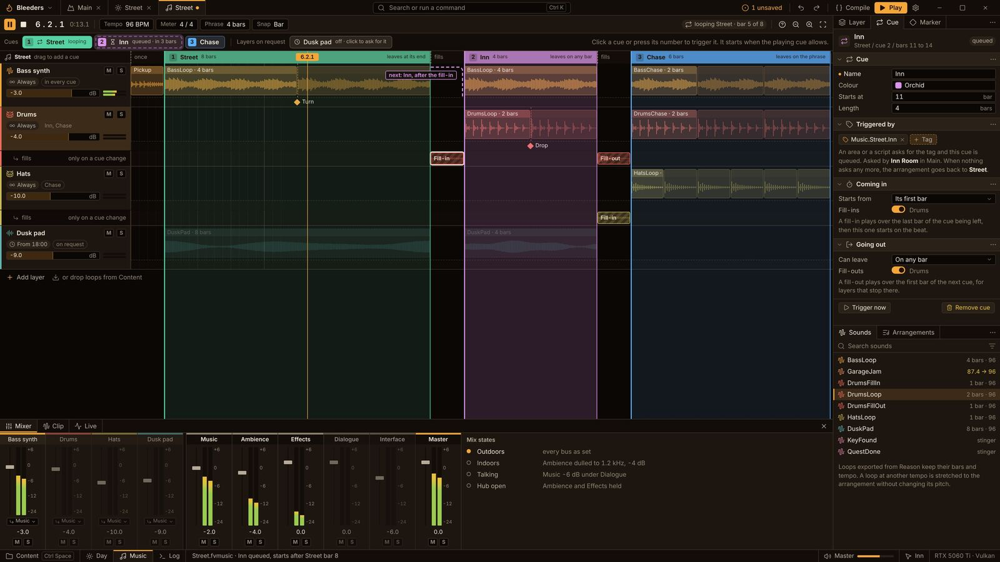
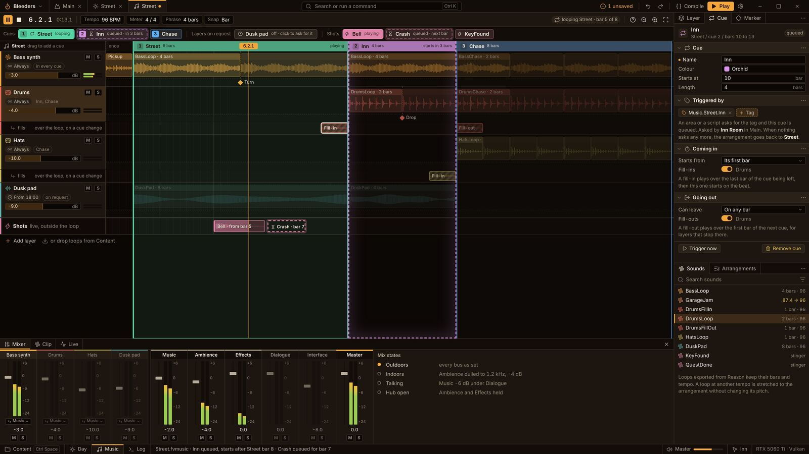
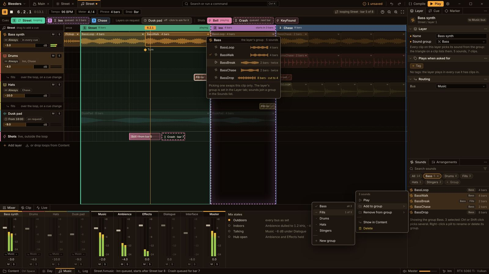

# Timeline kit

The design of everything with time in the editor (rule R28 of `EditorUi.md`, owner 2026-11-28): the music editor's arrangement, the Day dock and the shot timeline share one ruler, one lane surface, one transport and one mixer strip. The approved mockups are the spec, measure for measure; the views that are not built yet (cues, fills and shots in the arrangement, issues #376 to #378) are drawn from the same controls.

## Type and colour

- Text is the editor's (Inter), 12 px; labels in rulers and lane notes 10.5 to 11 px; the transport's position 15 px semibold with a little letter spacing.
- Surfaces: input `EditorDeepBrush`, base `EditorFrameBrush`, panel `EditorPanelBrush`, raised `EditorControlBrush`; text, muted and hint as the theme's. Sub lanes and raised lanes sit on `EditorRaisedLaneBrush`.
- Tints: layers take `EditorTrack1` to `EditorTrack6` (#F5A639, #E27641, #F26A5D, #C9B957, #63B5B4, #DF84A8), cues `EditorCue1` to `EditorCue8` (#56D1A3, #D892E8, #58B0FF, #E7B643, #8CC36D, #E27641, #F08698, #63B5B4), and ink on a filled tint is `EditorCueInk` (#1A1208). Washes mix a tint into the ground in Oklab (`ThemeColors.Mix`, the CSS `color-mix` of the mockups).

## Ruler

- 24 px. Labels where they are 28 px apart or more (bars from 1, hours as `HH:00` from 90 px, seconds from 56 px); a phrase's first bar, midnight and the whole seconds bold. Beats and minor lines are drawn only 12 px or more apart, and snapping takes the finest line drawn.
- The position chip: 44 by 15 px in the accent, the position's text in accent ink, over the position line. Times outside a repeating scale's period (before 00:00, after 24:00) are shaded.
- Region tabs ride the ruler: a 78% wash of the region's tint with ink, its key, name and length.

## Lanes

- A lane is 84 px, a sub lane 30 px. Rows carry the scale's grid: sections at full line colour, majors at 55%, minors at 22%.
- Clip: 5 px inset, radius 3, a 14 px title strip; body 20% of the tint, border 55%, title 42%; a repeated pass of a loop at 72%; the waveform in the tint.
- Fill: 3 px inset, 5 px stripes at 135 degrees, its name bold and centred with a halo; a 2 px ring when selected.
- Marker: a 9 px diamond with its label. Key: a diamond on the lane's middle.
- Bands over the lanes: a live region 9% of its tint with an inner outline; a queued one dashed 2 px with a glow that pulses on the beat; an idle one at 55% of the base with a 38% tab.
- Lane header: a 3 px edge in the lane's tint, icon, title semibold, note, buttons, and its own rows under them; a sub lane indents 22 px and hides its rows.

## Transport

- A 34 px bar on the panel colour with a line under it: play (22 px, filled in the accent; pause while playing), stop (twice back to the start), loop, the position (15 px semibold) and the clock time faint, then the fields, then the tools at the far end.
- A field is 22 px, radius 4, on the input colour with a line border, its name 11 px in the hint colour before its value and unit (Tempo 96 BPM, Meter 4 / 4, Phrase 4 bars, Snap Bar).

## Triggers

- 24 px, radius 5, a 16 px key box (10.5 px bold ink), the icon at 11 px, the name semibold and a note.
- Idle: a 14% wash of the tint with a 55% border. Live: filled in the tint, ink text, the repeat icon. Queued: a dashed 2 px border with a 3 px glow pulsing on the beat, the hourglass icon.

## Mixer

- A strip is 88 px: the name 22 px high under a 3 px bar in the layer's tint (a bus's name bold on the base colour), then the fader (18 px, a 18 by 9 px cap, -48 to +6 dB, 0 dB marked), two 8 px meters (green to 72%, yellow to 92%, red above) and the scale (+6, 0, -6, -12, -24 at 9 px), the route, the gain, and mute and solo (18 by 16 px). A silent strip shows at 55%.

## Tabs, lists and filters

- Tabs: a 26 px bar on the base colour with a line under it, tabs 25 px with a hairline between them, the chosen one on the panel colour with a 2 px accent bar at its foot. With `chips`, 20 px rounded filters, the chosen one washed in the accent with an accent border.
- Pills: 20 px, radius 10, on the raised colour with a line border, the count faint; the chosen one in the accent's wash with an accent border and a cross; the add pill dashed.
- Lists: Ctrl adds, Shift takes the run, Ctrl+A takes all, a right-click on a chosen row keeps the choice; menus mark what the choice holds with a tick (all of it) or a dash (some of it).
