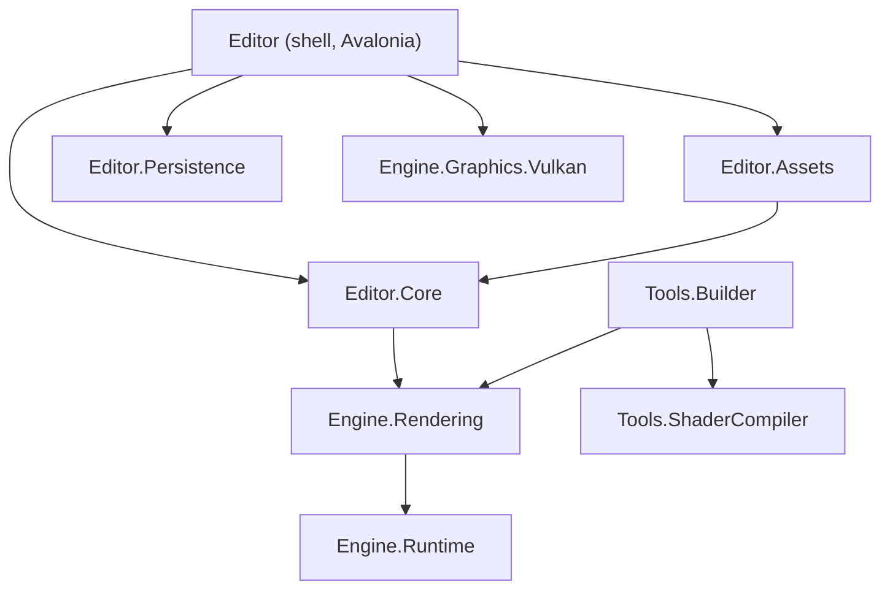

# FlickerVoid Engine plan

Decided with the owner on 2026-11-18. Each roadmap stage ends in something that can be run and judged before the next one starts.

## Decisions

| Topic | Decision |
| --- | --- |
| Foundation | Own engine on open-source libraries: Silk.NET, Jolt (BepuPhysics until 2026-11-25), Arch, SharpGLTF. Stride and MonoGame are references. |
| Stride code | Copy and adapt its MIT Vulkan backend and light shaders, keeping the licence notice |
| Look | Orthographic 2.5D: 3D scenes, hand-drawn textures, a 2D feel. Not 2D-first, not photoreal. Lighting first. |
| Indirect light | Irradiance probes traced live by rays where the GPU has ray queries, baked through the same rays for the rest (owner, 2026-11-25) |
| .NET | .NET 10 LTS, NativeAOT for release builds |
| Graphics | Vulkan 1.3 only, on Windows and Linux. Direct3D 12 was dropped after stage 3: every RTX feature (DLSS frame generation and ray reconstruction, Mega Geometry, shader execution reordering, cooperative vectors, RTX IO) is on Vulkan, and what D3D12 adds (work graphs, sampler feedback, Xbox) isn't in the plan |
| Shaders | HLSL, compiled by DXC to SPIR-V |
| Entities | Arch (archetype ECS, NativeAOT friendly) |
| Asset text | JSON through System.Text.Json source generation |
| Editor | Avalonia on Windows and Linux, on Avalonia's Vulkan backend: the viewport shares a Vulkan texture and semaphores with it through Avalonia's GPU interop (`Source/Editor`) |
| Platforms | One codebase for Windows and Linux; OS-specific work for Windows first, with a TODO on the Linux side |
| Gameplay | The Unreal project is the reference; NGN ports from it |
| Projects | `Documents/FlickerVoid/<Project>`; the game is Bleeders, in its own repository (`tec-sx/Bleeders`) building against the engine `FLICKERVOID_ENGINE` names |

## Architecture

- Runtime, builder and editor are separate programs that share asset schemas. The runtime never references the editor.
- The source is split three ways (owner, 2026-11-20): `Source/Engine` holds the modules games ship with, `Source/Tools` the content tools (Builder and ShaderCompiler), and `Source/Editor` the editor, itself four projects so that only its shell uses Avalonia. Engine sources never reference Tools or Editor; engine tests may use Tools to compile shaders.

- The editor changes its world only through `EditorScene`, one edit at a time, each raising `Edited`, so undo and redo can later record the same edits. Unsaved material and mood edits live in `UnsavedContent` until they are saved or discarded.
- Assets are text on disk (diffable) and binary when built. The builder caches by content hash and runs the same in the editor and in CI.
- Entities and components on Arch; systems update one component type at a time.
- Scenes and spawning go through scene files and factories; scene proxies load and unload whole worlds.
- Game code is plain C#. Hot reload for code and assets in development.
- Pressing Play runs the game in its own process, so a crash in game code never takes the editor down.
- Rendering reads a render world, not the game world: each frame an extractor copies cameras, meshes, lights and volumes into a `RenderScene`, which a later stage can extract on the game thread and draw on a render thread. Drawing is an ordered pipeline of render passes (skinning, light gathering, shadows, the scene's acceleration structures, geometry into the G-buffer, screen shadows, deferred lighting, post) sharing a frame context; features are added as passes. Barriers stay explicit until a frame graph earns its place.

## Look and lighting

- Orthographic and perspective cameras (owner, 2026-11-18). The orthographic one snaps to whole pixels so painted textures don't shimmer.
- Simple first (owner, 2026-11-18): a sun and ambient light and a viewer for a painted test room come before the styled shading, so the look can be judged early.
- Scenes are real 3D geometry with painted textures; characters are skinned meshes with painted textures. Painted cards and decals add 2D detail.
- One shading model with artist controls per material (ramp softness, wrap, rim, specular, emissive, shadow tint) on physically based light maths. Stage 4 shipped plain diffuse; the controls come with the editor (owner, 2026-11-19), where they can be tuned live.
- Deferred clustered lighting for many point, spot and directional lights (owner, 2026-11-25, in place of clustered forward): meshes are drawn into a G-buffer and lit in one compute pass, so ray tracing on RTX and DLSS can read the frame's surfaces.
- Shadows: one orthographic sun shadow map fitted to the view, a shadow atlas for local lights, soft filtering, contact shadows; traced where the GPU has ray queries (below), softened by the sun's width and the lamps' sizes. Painted cards cut out their clear paint, in shadows too.
- Ray tracing on RTX (owner, 2026-11-25): where the GPU has ray queries, the scene's acceleration structures are built every frame for ray traced shadows, ambient occlusion and probes; elsewhere the shadow maps, screen-space shadows and baked probes stay.
- Light cookies: spot lights project painted textures.
- Irradiance probes for bounce light, each with a map of how far it sees so light doesn't pass through walls: traced live where the GPU has ray queries, baked into a file for the rest.
- Volumetric fog lit by the same lights.
- Post: ambient occlusion, bloom, colour grading per area or mood, paper or grain overlay.
- Lighting moods as data assets the story switches through facts and conditions.

## Roadmap

0. **Skeleton.** Solution, build settings, CI on Windows and Linux, CLAUDE.md, this plan. Gate: green CI on both.
1. **Gameplay core, pure C#.** Definitions and fragments, tags, facts, conditions and effects with compare, scales with bands and links, ranking, ported with their Unreal tests. Gate: the social rules (standing, fame, titles) pass in tests on Linux CI.
2. **Runtime foundation.** Silk.NET window and input, main loop with fixed and variable update, Arch entities, resource loading by path, logging and a console, BepuPhysics. The rules that read entities or world services port with it: attitude, disguises and recognized fame, and the conditions and effects that use the context's instigator, target or services. Gate: a sample spawns entities from a scene file and physics bodies fall.
3. **Graphics layer.** A thin layer over Vulkan adapted from Stride, HLSL through DXC. Ends with a spike: the renderer inside an Avalonia window on Windows and Linux. Gate: a textured mesh renders on Vulkan on Windows and Linux. (Direct3D 12 was built for this stage and dropped after it.)
4. **Lighting renderer.** Everything in Look and lighting, plus basic glTF import. Gate: a painted test room with a character and dozens of lights at 60 fps.
5. **Asset pipeline.** Text assets with schemas, the builder with a content-hash cache, texture compression, glTF import, hot reload. Gate: edit a texture or a light in a file and the running game shows it within a second.
6. **Editor.** Avalonia: project browser for `Documents/FlickerVoid`, scene view, inspector generated from schemas, light editing and probe baking, the per-material shading controls, layered painted textures (an idea to explore), Play in a separate process. Gate: build and light a room without touching a text file.
7. **FlickerVoid systems and the game project.** The whole Unreal project ported (owner, 2026-11-20): the entity model, data assets and flow graphs first, then interaction, inventory and outfits, dialogue and story graphs, maps, UI, AI, saves. `Docs/Port.md` maps every Unreal plugin, module and script to its engine module or project path, with the order. Gate: the basic story loop from the Unreal milestone (inventory, dialogue, a quest, map, interaction) plays in NGN. Met on 2026-11-22: the project's `StoryLoopTests` play the cellar key quest on `Main.fvscene` (talk, accept, take the key, open the cellar, return for the reward) and save, restart and load in the middle of it; the launcher quick saves with F5 and loads with F9. The version bump waits for stage 6's gate.

A development-only debug UI (Dear ImGui through Hexa.NET.ImGui, in `Source/Engine/Debug`) arrived after stage 4 (owner, 2026-11-19): engine panels for frame, CPU, memory and GPU statistics, the console, the renderer's switches, debug views and moods, plus a public `DebugWindow` API for per-project panels (the samples have theirs). The editor will use its own Avalonia UI instead.

A camera director arrived during stage 7 (owner, 2026-11-22; design: the "Camera director design" doc): the camera is directed, never player-controlled. Shots are camera entities whose keys form a rail and a timeline, played over time or tracking the player; the director switches shots with cuts, cross-fades, fades and blends, keeps a stack for cutscenes, adds bounded camera layers (follow, look, shake, zoom punch), and is driven by trigger areas, effects and flow nodes. It landed in slices: rails, shots, the timed drive and cuts; the tracked drive and markers; transitions; layers; triggers, effects, flow nodes and saves; the demo in `Main.fvscene` (the room shot, the window spot, the cellar door and a key-found cutscene); the editor (rails and keys in the viewport, a timeline with scrubbing, trigger area boxes). Camera layers live in `cameraRig` data assets and cue conditions are fact conditions, since scene components hold no polymorphic data.

Stage 1 runs in parallel with stages 2 and 3.

Later (owner, 2026-11-20): an engine asset registry, with synchronous and asynchronous runtime loading and unloading of packed data and its own runtime persistence.
